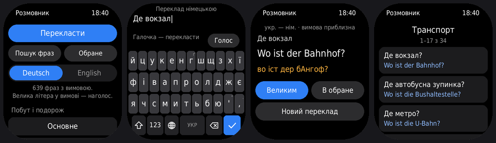
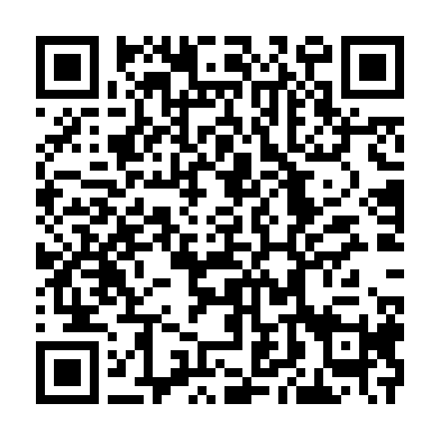

# Перекладач і розмовник для Amazfit Bip 6 — українська ↔ німецька й англійська

- **Перекладач** — будь-який текст, через телефон: Zepp має бути запущений, телефон — з інтернетом.
- **Розмовник** — понад 630 фраз для кожної мови з вимовою українськими літерами. Працює без телефона й інтернету.

## Встановлення

Zepp → Профіль → Amazfit Bip 6 → самий низ → «Режим розробника» → кнопка сканування вгорі праворуч → відскануй QR (показати його можна з іншого екрана):

Посилання в QR: `zpkd1://raw.githubusercontent.com/netherm3-coder/bip6-phrasebook/build/bip6-phrasebook.zpk`

Оновлення — той самий QR; обране й налаштування зберігаються. Ключі й реєстрація не потрібні.

## Перекладач

- **Перекласти** на головній → набери текст → галочка.
- **Кирилицею** — переклад мовою, вибраною на головній (**Deutsch / English**). **Латиницею** — переклад українською; мову оригіналу перекладач визначає сам (німецька чи англійська — неважливо).
- **Голос** — системний голосовий ввід, якщо годинник дає його програмам. Якщо ні, кнопка зникає — тоді лише клавіатура.
- **Вимова** — для німецької, українськими літерами з наголосом. Вона автоматична (за правилами читання), тому підписана «приблизна»: у звичайних словах збігається з ручною вимовою розмовника на 97 %, помилки бувають у запозиченнях і складених словах. Для англійської вимови немає.
- **Великим** — переклад на весь екран, щоб показати співрозмовнику. **В обране** — переклад лишиться на годиннику й відкриватиметься без телефона. Усі переклади потрапляють у «Нещодавні».
- **Без телефона чи інтернету** з'являється кнопка **«У фразах»** — той самий текст шукається в розмовнику.
- Перекладає Google Перекладач (без ключа). Якщо він не відповів — запасна адреса Google, далі MyMemory. Текст іде з телефона на ці сервіси — не перекладай нічого секретного.

## Розмовник

**Мова:** перемикач **Deutsch / English** на головній. Вибір запам'ятовується.

**Побут і подорож:** основне, питання й слова (хто, де, коли, скільки, великий/маленький…), знайомство, числа, час і дати, погода, транспорт, місто й дорога, магазин, кафе й їжа, житло, здоров'я, екстрене, документи, гроші й зв'язок, «Що вам скажуть» (фрази, які кажуть вам: на касі, в поїзді, на контролі — спершу іноземною).

**Служба:** звання й посади, звертання й доповідь, команди, навчання, розпорядок дня, спорядження, зброя й стрільбище, тактична медицина, радіозв'язок, місцевість.

Англійська — не переклад німецької: звання НАТО/США/Британії, команди англомовних армій, радіопроцедура (Over, Roger, Wilco, Say again, фонетичний алфавіт НАТО), «Що вам скажуть» — як кажуть у США й Британії. Де варіанти різні, подано обидва через «/».

- **Списки** — сторінками до 20 фраз (34 фрази — дві по 17): «Наступні» внизу, «Попередні» вгорі. «Назад» одразу виходить зі списку.
- **Фраза:** українською, іноземною й вимова. `<` `>` — сусідні фрази, по всьому списку, не лише по сторінці.
- **Вимова:** велика літера — наголос: `ентшУльдіґунґ`, `стЕйшен`. ґ — g, г — h. В англійській th — «с» або «з» (`сенк ю`, `зе`), w — «у» (`уЕа`).
- **Великим** — іноземна фраза на весь екран. Торкнись — назад.
- **В обране** — обране спільне для обох мов і перекладів, позначене DE / EN.
- **Нещодавні** — 20 останніх відкритих фраз і перекладів, на головній.
- **Пошук фраз** — у вибраній мові: українською, іноземною (латиницею; німецькі умлаути можна не набирати: `strasse`, `ubermorgen`) або за вимовою. Під полем одразу видно, скільки знайдено. Галочка — показати всі.
- Звання: відповідники приблизні — системи звань різні.

## Як додати чи виправити фразу

Фрази лежать у `.data/de.txt` і `.data/en.txt`, по одній на рядок: `українською | іноземною | вимова`. Категорії в обох файлах однакові. Після змін: `node .tools/gen-data.js` — перевірить символи, наголоси й категорії та оновить `data/` (фрази й готовий індекс пошуку).

## Як це збирається

Після кожного пушу в `main` (і раз на добу) GitHub Actions збирає preview-пакет і кладе його в гілку `build` (`bip6-phrasebook.zpk` — на нього вказує QR).

## Структура

Кожна сторінка вантажить лише те, що їй треба: головна, переклад, обране й фраза — без фраз розмовника, категорія й пошук — лише фрази своєї мови.

- `page/index.js` — головна (кожен рядок — одна кнопка)
- `page/translate.js` — введення перекладу (клавіатура, голос, запит до телефона); `page/result.js` — результат
- `app-side/` — сервіс у Zepp на телефоні: `translate.js` — Google і запасні адреси; `shared/pron-de.js` — вимова німецькою за правилами
- `page/cat_de.js`, `page/cat_en.js` — категорія німецькою / англійською (`lib/catpage.js`)
- `page/search_de.js`, `page/search_en.js` — пошук фраз (`lib/searchpage.js`)
- `page/items.js` — обране, нещодавні, знайдене; `page/phrase.js` — фраза; `page/big.js` — показ великим
- `lib/listpage.js` — список сторінками; у пам'яті програми — виміряні висоти текстів, тож список після «назад» будується без вимірювань
- `data/` — згенеровані: `meta.js` (мови, категорії), `de.js` / `en.js` (фрази), `de_idx.js` / `en_idx.js` (готовий індекс пошуку)
- `utils/translate.js` — напрямок перекладу, тексти помилок; `utils/search.js` — пошук; `utils/store.js` — мова, обране, нещодавні; `keyboard/` — клавіатура УКР/ENG (з bip6-notes)
